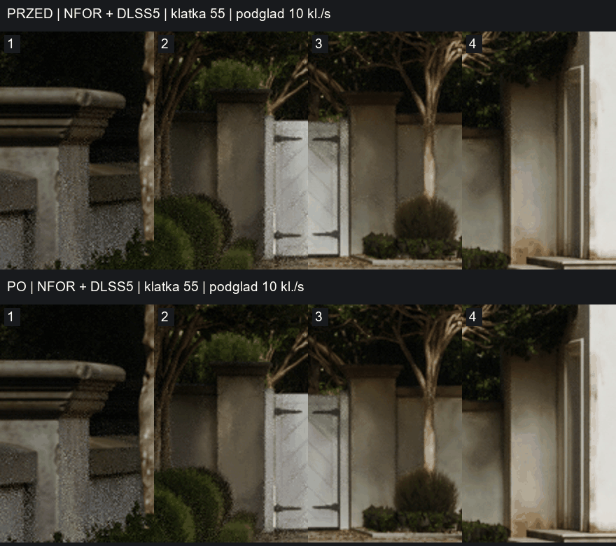
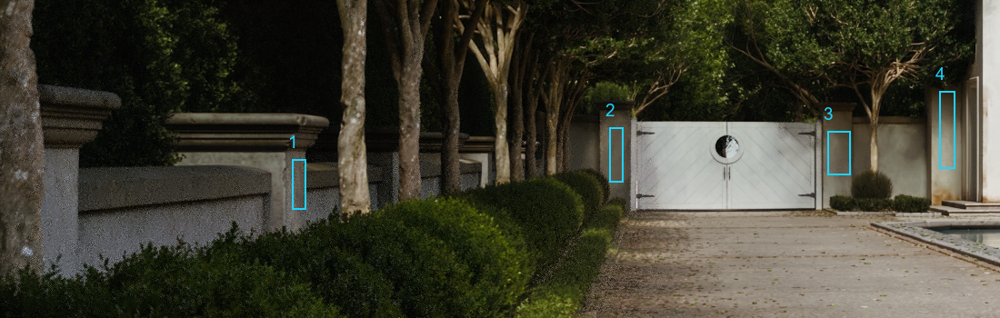

# Offline Path Tracer / NFOR temporal history validation

## Problem and change

With 256 spatial samples per output image, legacy Movie Render Queue runs post
processing on intermediate Path Tracer images that it subsequently discards.
Evaluating NR on these partial images advances its history with unconverged
inputs. NFOR also delivers an older color/depth image: with its default
`r.NFOR.FrameCount=2`, that image is two completed frames behind the latest one.
Using the latest camera/object motion with that image produces mismatched guides.

The change evaluates NR only after Path Tracer accumulation completes, preserves
cuts observed on skipped samples, and retains camera matrices and velocity buffers
for completed images. It selects guides for the image delivered by NFOR, resetting
NR across the initial raw-to-delayed-image transition and history discontinuities.
Both legacy MRQ and MRG set `OverrideOutputFrameIndexValue`; that field is not a
reason to disable delay compensation. The render validation below uses legacy MRQ.

The profile's NR strength/style are unchanged. Real-time evaluation cadence is
unchanged. `r.NGX.DLSSNR.OfflineTemporalFix` selects:

- `0`: previous behavior, including intermediate PT samples.
- `1`: completed images only, without NFOR guide delay compensation.
- `2`: completed images plus NFOR-aligned guides (default).

## Render comparison

Garden Villa, UE 5.8, Win64/D3D12, RTX 5090, 2026-10-14:

| Setting | Value in both final A/B runs |
| --- | --- |
| Output | 2560 x 1440 PNG |
| Frame range | 50–65 inclusive (16 frames per run) |
| Samples | 256 spatial, 1 temporal; AA override None |
| Warmup | 64 engine frames, 32 render warmup frames |
| Denoiser | `r.PathTracing.Denoiser=1`, `r.PathTracing.SpatialDenoiser.Type=1`, temporal denoiser name `NFOR` |
| NFOR window | `r.NFOR.FrameCount=2`; default denoising frame selection and frame-count condition |
| NR | Enabled, Post Tone, same profile and strength |
| Compared variable | `r.NGX.DLSSNR.OfflineTemporalFix`: 0 versus 2 |

**PR #2's Post Tone color-space correction was present in both render builds.**
It is excluded from this PR's diff, so the comparison isolates the offline-history
change, rather than the color-space correction. The local build also used a
separate checksum compatibility change for the installed adapter. This PR does
not change runtime checksums or include NVIDIA binaries.

The final render completed successfully with 16 output PNGs. The log confirms
16 NR evaluations of completed `256/256` images, guide delay `2`, successful NR
submissions at 2560 x 1440, and NFOR denoising with five history images.

The preview is enlarged 2x and displayed at 10 frames/s, with a pause at each end
of the loop. **Top: before; bottom: after.** The loop reset is not a render defect.



## Local temporal measurements

Analyze frames 55–65 (11 settled images / 10 consecutive pairs), excluding the
initial NFOR history transition. Convert the original PNGs to 8-bit luma using
`0.2126 R + 0.7152 G + 0.0722 B`. Fit a subpixel translation on a larger crop
blurred with Gaussian sigma 2. Compare the aligned images in the marked patch,
using temporal RMS after Gaussian sigma 8 to suppress pixel grain and emphasize
broader brightness/detail variation. The reported value is the mean pairwise RMS.
The filtering is **measurement only**; it is not applied to rendered output.

| Area | Before RMS (0–255) | After RMS (0–255) | Reduction |
| --- | ---: | ---: | ---: |
| 1. Near left wall pillar | 2.3428 | 0.4588 | 80.4% |
| 2. Left of gate | 3.0158 | 0.3863 | 87.2% |
| 3. Right of gate | 2.8280 | 0.3688 | 87.0% |
| 4. Narrow wall beside building | 1.5420 | 0.2579 | 83.3% |
| Main facade, left | 0.3214 | 0.1219 | 62.1% |
| Main facade, right | 1.0618 | 0.1719 | 83.8% |



These are local diagnostics, **not a universal perceptual flicker score or proof
of zero flicker**. The sample is short, the patches are small, and separate runs
can differ in noise and animated foliage. A separate 10-frame NFOR-only control
also showed much smaller brightness changes in these areas. Residual NR variation
and NFOR's legacy MRQ start/end-of-shot limitations remain. Full-animation output,
other scenes, MRG, tiled rendering, and other engine versions were not validated.

Exact crops, per-pair translations, multiscale measurements and reductions are in
[mrq-nfor-metrics.json](mrq-nfor-metrics.json). The numerical analysis uses original
PNGs, not the palette-quantized preview GIF. The proprietary scene and full PNG
sequences are not included; the generic analysis script can be applied to locally
rendered matching sequences with the documented coordinates.

## Build and regression checks

- UE 5.8 Win64 Development build: succeeded (MSVC 14.44.35228 / SDK 10.0.22621.0).
- `DLSS5OneMinus.OfflineHistory.CadenceAndNFOR`: passed, 0 warnings/errors.
- Coverage: one evaluation per 256 samples, cuts on skipped samples, NFOR startup,
  previous delivered frame, ring wrap, sample-count/size/delay changes, one-sample
  rendering, missing sample state, and separate view histories.
- Actual MRQ render: successful completion and the runtime checks above.

The recorded checks were performed on the local combined render build described
above. See [validation summary](mrq-nfor-validation.json) and the
[selected render log lines](mrq-nfor-render-excerpt.txt).

To run the automation test in a UE 5.8 host project with the plugin installed:

```text
UnrealEditor-Cmd.exe <Host.uproject> -NullRHI -Unattended -NoSplash -NoSound "-ExecCmds=Automation RunTests DLSS5OneMinus.OfflineHistory" "-TestExit=Automation Test Queue Empty"
```

For a render A/B, create two separate MRQ jobs with the same map, sequence, NR
profile and settings above. Change only `r.NGX.DLSSNR.OfflineTemporalFix` from 0
to 2. Enable `Log LogDLSS5OneMinusOffline Verbose` to inspect the evaluation cadence
and resets. Allow the NFOR history to fill before assessing temporal stability.

For the recorded frame naming and regions, install Python's `numpy`, `Pillow` and
`scipy`, then run:

```text
python Docs/tests/analyze_mrq_nfor.py --before <before_png_directory> --after <after_png_directory> --output comparison.json
```
